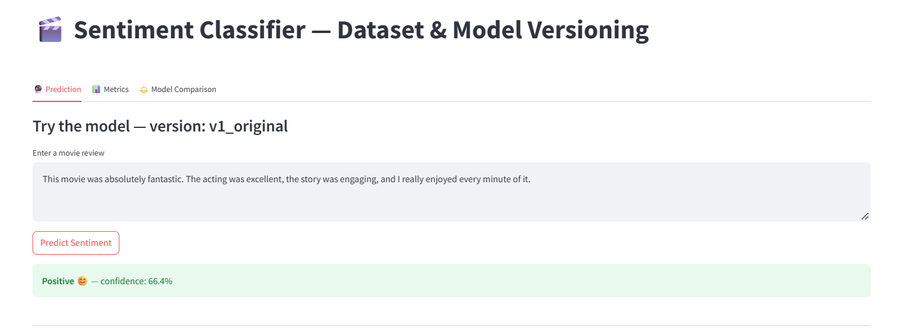
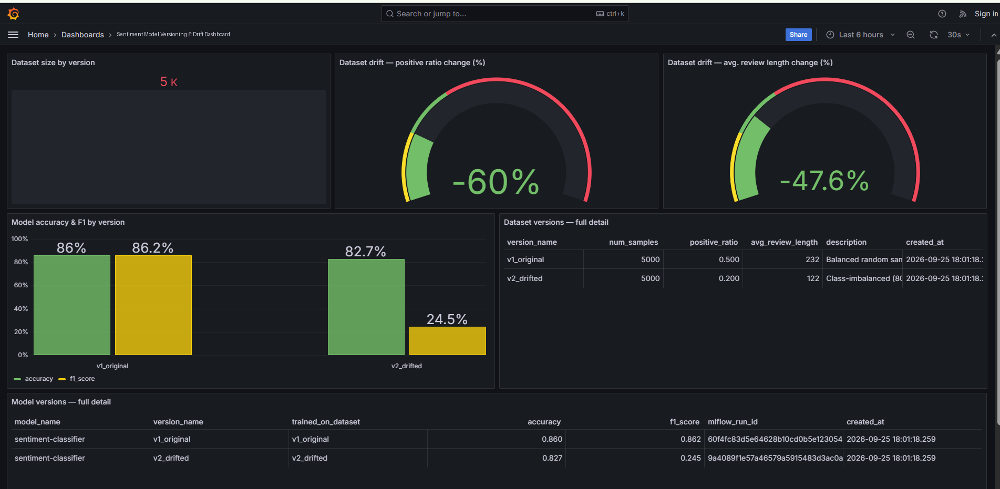
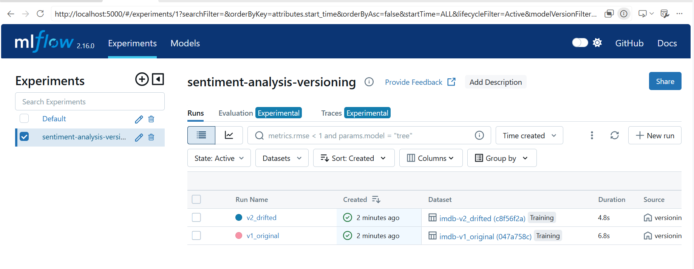
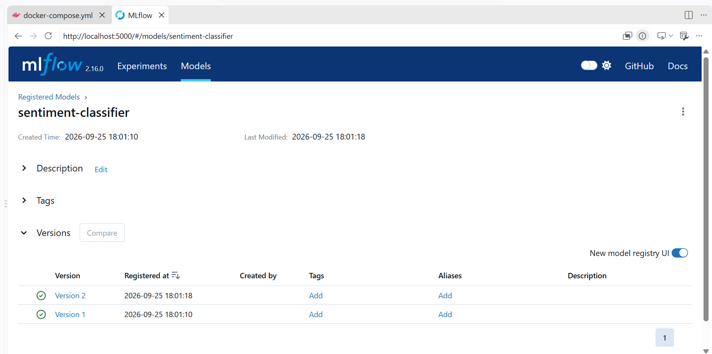

# Sentiment Analysis MLOps Pipeline

End-to-end machine learning project on **IMDB movie reviews**: from NLP preprocessing and model comparison, to a **containerized API on Google Cloud Run**, to **dataset/model versioning and drift monitoring** with MLflow, PostgreSQL and Grafana.

    

## Highlights

- **Compared two approaches** on the full 25,000-review test set: TF-IDF + Logistic Regression (**88% accuracy**) vs. fine-tuned DistilBERT (**89%**). Chose Logistic Regression for deployment: ~1 point lower, but far smaller, faster, cheaper and easier to explain.
- **Shipped it**: FastAPI service + minimal web UI, packaged with Docker, deployed to Google Cloud Run.
- **Monitored drift**: built two dataset versions (balanced vs. drifted), trained and registered a model for each in MLflow, and visualised the effect in Grafana.
- **Key finding**: on the drifted dataset (80% negative), accuracy stayed at ~83% while **F1 collapsed from 0.86 to 0.24**, so accuracy alone would have hidden a serious failure.

## Architecture

```
            ┌────────────── notebooks/ ──────────────┐
IMDB data → │ clean → tokenize → lemmatize → TF-IDF   │ → model.pkl (model + vectorizer + preprocessing)
            │ LogReg baseline vs. DistilBERT          │
            └─────────────────────────────────────────┘
                                  │
              ┌───────────────────┴────────────────────┐
              ▼                                        ▼
        api/ (FastAPI + Docker)                 mlops/ (docker compose)
        POST /predict, /health, web UI          Postgres ─ MLflow ─ Streamlit ─ Grafana
        → Google Cloud Run                      dataset v1 vs v2 (drift), model registry
```

## Results

### Model comparison (25,000-review test set)

| Model | Accuracy | F1 (macro) |
|---|---|---|
| TF-IDF + Logistic Regression | 0.88 | 0.88 |
| DistilBERT (fine-tuned on a 4,000-review subset, T4 GPU) | 0.89 | 0.89 |

### Drift experiment

| | Dataset v1 (balanced) | Dataset v2 (drifted) |
|---|---|---|
| Positive ratio | 50% | 20% |
| Avg. review length | ~232 words | ~122 words |
| Accuracy | 0.86 | 0.83 |
| F1 | 0.86 | 0.24 |

## Screenshots

| Prediction UI | Drift dashboard (Grafana) |
|---|---|
|  |  |

| MLflow experiment runs | MLflow model registry |
|---|---|
|  |  |

More in [`docs/images/`](docs/images).

## Repository layout

```
notebooks/01_nlp_pipeline.ipynb   Data exploration, preprocessing, training, evaluation, model export
api/                              FastAPI app, Dockerfile, web UI, trained model (models/model.pkl)
mlops/                            docker-compose stack: Postgres, MLflow, Streamlit, Grafana
docs/images/                      Screenshots
```

## Run it

### 1. Prediction API (Docker)

```bash
cd api
docker build -t sentiment-api .
docker run -p 8080:8080 sentiment-api
```

Open http://localhost:8080 for the UI, or call the API:

```bash
curl -X POST http://localhost:8080/predict \
  -H "Content-Type: application/json" \
  -d '{"text": "An excellent movie, I loved every minute."}'
# {"text": "...", "prediction": "positive", "label": 1, "confidence": 0.9...}
```

Deploy to Cloud Run: `gcloud run deploy sentiment-api --source api --region <region> --allow-unauthenticated`

### 2. Versioning & drift monitoring stack

```bash
cd mlops
docker compose up --build -d
docker compose exec app python versioning.py   # builds v1/v2 datasets, trains + registers models (a few minutes)
```

- MLflow: http://localhost:5000
- Streamlit app: http://localhost:8501
- Grafana: http://localhost:3000 (local demo credentials `admin` / `admin`, change for any real deployment)

See [`mlops/README.md`](mlops/README.md) for details.

### 3. Notebook

Open `notebooks/01_nlp_pipeline.ipynb` in Jupyter/Colab. The DistilBERT section needs a GPU (e.g. a free Colab T4). Outputs are saved in the notebook.

## Tech stack

Python · pandas · scikit-learn · NLTK · Hugging Face Transformers/Datasets · PyTorch · FastAPI · Uvicorn · Docker · Google Cloud Run · MLflow · PostgreSQL · Grafana · Streamlit

## Design decisions & limitations

- **Preprocessing differs by model on purpose**: the classical model uses cleaned/lemmatized text; DistilBERT gets raw text because its tokenizer was pretrained on natural language.
- **The preprocessing code is saved inside `model.pkl`** and re-applied by the API, so training and serving cannot silently diverge. Executing code from a pickle is only safe for files you trust, so only load models you created.
- The drift is **synthetic** (deliberately created), not observed in production.
- The model is specific to the movie-review domain; the deployment is a learning setup (no auth, autoscaling tuning or CI/CD).
- **Next steps**: automated drift alerts with thresholds, CI/CD, scheduled retraining, testing on other domains.

## Author

Samah Sayed

## License

MIT, see [LICENSE](LICENSE).
